# 4 · One remote, and popups on every screen

I no longer use "dashboards". I used to be heavily dashboard-focused, spending hours a week
tweaking highly custom dashboards that ran on screens in every room. Now there's **one remote**
for everything, and anything that needs my attention **appears on whatever screen is near me**,
then disappears everywhere once it's dealt with.

**The pattern:** an automation sets one piece of state in Home Assistant, such as
`input_boolean.washer_done`, `input_boolean.intruder_alert_active`, the lock being unlocked,
the leak sensor or `input_boolean.work_alarm_ringing`. Every screen watches that state and
draws its own popup. Pressing *Emptied* on the remote, the phone or the knob clears the same
state, so the popup vanishes from all of them at once.

| Washer done (remote) | Alarm (rotary knob) | Wall board at night |
|---|---|---|
| 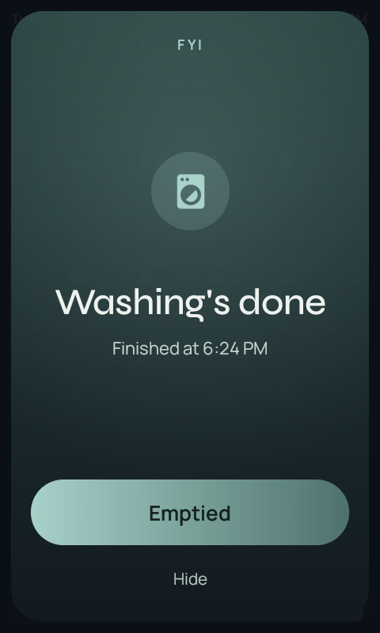 | 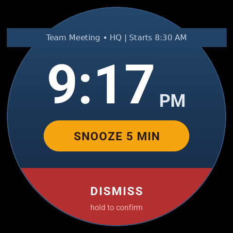 |  |

## The screens
- **The one remote:** an app I designed from the ground up
  ([astrion-dashboard](https://github.com/baes-cloud/astrion-dashboard)), running on affordable
  Sanytron Astrion HA100 Android remotes. It controls the whole home by **touch screen, physical
  buttons or voice** ("hey Pikachu"): TV, Plex, Sonos, lights, scenes, the lock, the robots and alerts.
  Alarm and warning popups wake the screen, info popups wait to be seen.
  [More on the remote below](#the-one-remote-up-close).
- **TVs and Nest Hubs:** both Nest Hubs and the lounge TV's screensaver show my own ambient
  page with the same popups, so the washer nags me from whichever screen I walk past.
  [More below](#tvs-and-nest-hubs-ambient-screens).
- **BæoRemote** ([baeoremote](https://github.com/baes-cloud/baeoremote)): a round ESP32-S3 knob
  by the couch for easy media-only control, inspired by B&O's Beosound Essence remote. Turn for volume,
  press to play/pause, hold for playlists, plus a night clock.
- **The hub knob** ([esp-rotary-display-ha-hub](https://github.com/baes-cloud/esp-rotary-display-ha-hub)):
  a second round knob in the bedroom for lights, scenes, climate, blinds and media.
- **Kitchen wall board:** split-flap style departures board on an old Raspberry Pi 400, which
  is also the standby HA: [rpi-departure-board](https://github.com/baes-cloud/rpi-departure-board).
- **Phone:** actionable notifications.
- **Speakers:** spoken announcements over whatever is playing (door, washer, leak, alarms).

### The remote's popup definitions
This is the whole configuration. Each popup is just "show this when that entity is in this
state", with buttons that call Home Assistant actions:

```json
{
  "alarm": {
    "ringing_entity": "input_boolean.work_alarm_ringing",
    "snooze_timer": "timer.work_alarm_snooze",
    "info_entity": "sensor.work_start",
    "snooze": {
      "service": "script.turn_on",
      "entity_id": "script.work_alarm_snooze"
    },
    "stop": {
      "service": "script.turn_on",
      "entity_id": "script.work_alarm_stop_and_start_day"
    }
  },
  "alerts": [
    {
      "id": "leak",
      "entity": "binary_sensor.0x0c2a6ffffe605def_water_leak",
      "state": "on",
      "severity": "alarm",
      "icon": "leak",
      "title": "Water leak",
      "message": "Leak sensor by the washing machine — since {since}"
    },
    {
      "id": "intruder",
      "entity": "input_boolean.intruder_alert_active",
      "state": "on",
      "severity": "alarm",
      "icon": "intruder",
      "title": "Intruder alert",
      "message": "Radar saw someone while away mode was on ({since})",
      "actions": [
        {
          "name": "All clear",
          "service": "input_boolean.turn_off",
          "entity_id": "input_boolean.intruder_alert_active"
        }
      ]
    },
    {
      "id": "door",
      "entity": "lock.lock_pro_0fa0",
      "state": "unlocked",
      "for_seconds": 600,
      "unless": {
        "entity": "input_boolean.front_door_keep_unlocked",
        "state": "on"
      },
      "severity": "warning",
      "icon": "door",
      "title": "Front door unlocked",
      "message": "Unlocked for {minutes} min (since {since})",
      "actions": [
        {
          "name": "Lock it",
          "service": "lock.lock",
          "entity_id": "lock.lock_pro_0fa0"
        },
        {
          "name": "Keep unlocked",
          "service": "input_boolean.turn_on",
          "entity_id": "input_boolean.front_door_keep_unlocked"
        }
      ]
    },
    {
      "id": "washer",
      "entity": "input_boolean.washer_done",
      "state": "on",
      "severity": "info",
      "icon": "washer",
      "title": "Washing's done",
      "message": "Finished at {since}",
      "actions": [
        {
          "name": "Emptied",
          "service": "input_boolean.turn_off",
          "entity_id": "input_boolean.washer_done"
        }
      ]
    }
  ]
}
```

### The washer, end to end
<details><summary><b>Washer · done</b> (click to expand)</summary>

```yaml
- id: '1790500000004'
  alias: Washer · done
  description: Washer finished → Washer done flag on (shows on the remotes), push
    with an Emptied button, Sonos announce if you're home and it isn't night / party
    mode. One reminder after 45 min. Flag clears on Emptied, on the remote popup,
    or when the next wash starts.
  triggers:
  - trigger: state
    entity_id: sensor.washer_job_state
    to: finish
    id: done
  - trigger: state
    entity_id: input_boolean.washer_done
    to: 'on'
    for: 00:45:00
    id: remind
  - trigger: state
    entity_id: sensor.washer_machine_state
    to: run
    id: start
  - trigger: event
    event_type: mobile_app_notification_action
    event_data:
      action: WASHER_EMPTIED
    id: emptied
  - trigger: state
    entity_id: input_boolean.washer_done
    to: 'off'
    id: cleared
  conditions: []
  actions:
  - choose:
    - conditions:
      - condition: trigger
        id: done
      sequence:
      - action: input_boolean.turn_on
        target:
          entity_id: input_boolean.washer_done
      - action: script.turn_on
        target:
          entity_id: script.notify_bae
        data:
          variables:
            title: Washing's done
            message: Finished at {{ now().strftime('%-I:%M %p') }}.
            data:
              tag: washer
              channel: Washer
              actions:
              - action: WASHER_EMPTIED
                title: Emptied
      - if:
        - condition: state
          entity_id: binary_sensor.bae_home
          state: 'on'
        - condition: state
          entity_id: input_boolean.auto_stay
          state: 'off'
        - condition: template
          value_template: '{{ not ((d in [6,0,1,2,3] and t >= 21*60) or (d in [0,1,2,3,4]
            and t < 7*60) or (d in [4,5] and t >= 23*60) or (d in [5,6] and t < 9*60))
            }}'
        then:
        - action: media_player.play_media
          target:
            entity_id:
            - media_player.club
            - media_player.bedroom_sonos
            - media_player.bathroom_sonos
          data:
            media_content_type: music
            media_content_id: media-source://tts/tts.home_assistant_cloud?message=The%20washing%20is%20done
            announce: true
            extra:
              volume: 15
          continue_on_error: true
    - conditions:
      - condition: trigger
        id: remind
      sequence:
      - action: script.turn_on
        target:
          entity_id: script.notify_bae
        data:
          variables:
            title: Washing's still in the machine
            message: Done {{ relative_time(states.input_boolean.washer_done.last_changed)
              }} ago.
            data:
              tag: washer
              channel: Washer
              actions:
              - action: WASHER_EMPTIED
                title: Emptied
      - if:
        - condition: state
          entity_id: binary_sensor.bae_home
          state: 'on'
        - condition: state
          entity_id: input_boolean.auto_stay
          state: 'off'
        - condition: template
          value_template: '{{ not ((d in [6,0,1,2,3] and t >= 21*60) or (d in [0,1,2,3,4]
            and t < 7*60) or (d in [4,5] and t >= 23*60) or (d in [5,6] and t < 9*60))
            }}'
        then:
        - action: media_player.play_media
          target:
            entity_id:
            - media_player.club
            - media_player.bedroom_sonos
            - media_player.bathroom_sonos
          data:
            media_content_type: music
            media_content_id: media-source://tts/tts.home_assistant_cloud?message=Reminder,%20the%20washing%20is%20still%20in%20the%20machine
            announce: true
            extra:
              volume: 15
          continue_on_error: true
    - conditions:
      - condition: trigger
        id:
        - start
        - emptied
      sequence:
      - action: input_boolean.turn_off
        target:
          entity_id: input_boolean.washer_done
    - conditions:
      - condition: trigger
        id: cleared
      sequence:
      - action: script.turn_on
        target:
          entity_id: script.notify_bae
        data:
          variables:
            message: clear_notification
            data:
              tag: washer
  mode: queued
```

</details>


## The one remote, up close
The [Sanytron Astrion HA100](hardware.md#screens-and-controls) is an affordable Android remote
with a touch screen, real buttons, a mic and a charging dock. Its own app was too slow, so I
designed [a replacement](https://github.com/baes-cloud/astrion-dashboard) from scratch. It talks
straight to Home Assistant, and almost everything on it (cards, buttons, popups) comes from one
JSON file on the remote, so most changes don't need a new build.

| Main | TV + Plex | Music | Search music |
|---|---|---|---|
| 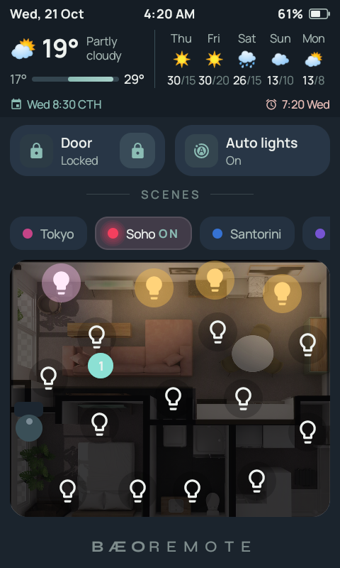 | 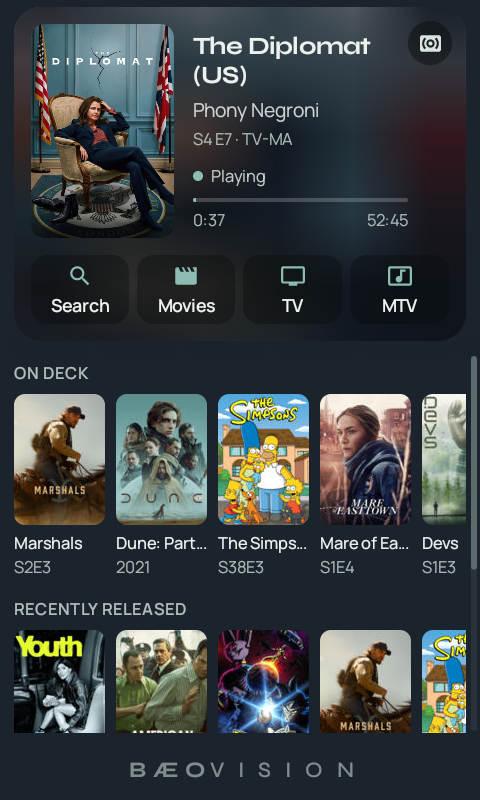 |  |  |

- **One page per physical button.** Light opens Main (weather, the next alarm and event, the
  door, an *Auto lights* switch, scenes and the live floorplan). The curtain button opens TV,
  where one tap on a poster wakes the TV, switches it to the Google TV Streamer and starts that
  exact episode. Media is the Sonos: four mixes, search across everything in Music Assistant,
  and which rooms are playing. Climate is the aircon, fan and blinds.
- **The floorplan is live.** Lights glow where they're on (tap to toggle, hold for brightness and
  colour), the robot vacuum shows in the room it's in, and the radar's people appear as dots.
- **Colour buttons** jump straight into Netflix, Plex, ABC iview or the ambient screen on the TV;
  holding one sets a scene.
- **A guide for guests.** Holding Menu opens short answers to "how do I...", a walkthrough that
  asks for real button presses (nothing happens in the house while it's open), and puts a
  one-page version on the TV at the same time.

| Guide | Plex library | Docked by day | Docked at night |
|---|---|---|---|
| 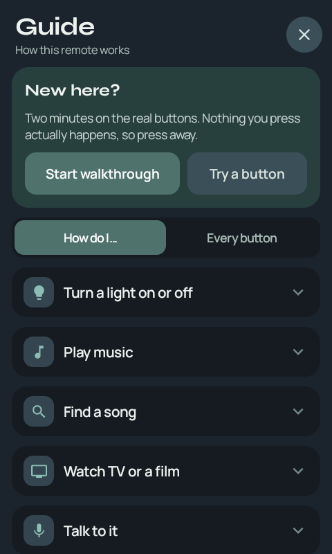 | 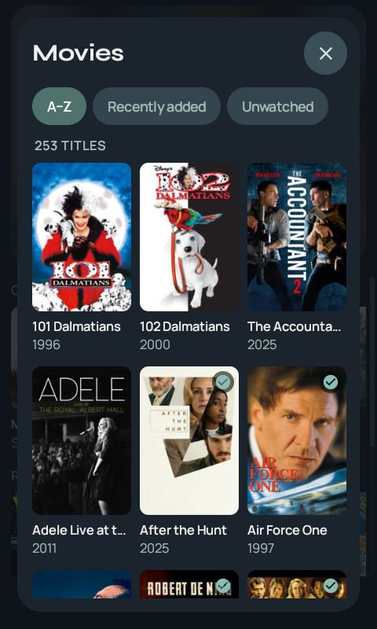 |  | 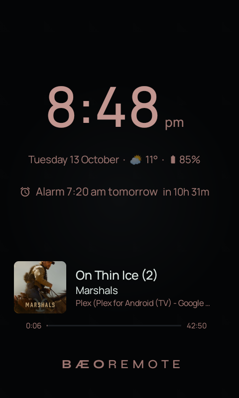 |

- **On the dock** it turns into a clock with the next alarm and what's playing, warm amber at
  night, and listens for "hey Pikachu". Off the dock it sleeps properly to save the battery.

## TVs and Nest Hubs: ambient screens
The mini PC behind the lounge TV serves one more page: **Bæovision**. The TV and the Nest Hubs
used to show Google's own screensavers. Now they show the house.

**On the TV.** I wrote a tiny Android screensaver app for the Google TV Streamer that just
shows this page, and set it as the Streamer's screensaver over ADB. So whenever the TV sits
idle, instead of stock photos it shows the time, the weather and a five-day forecast, what's
playing in the lounge with a pill for each room's speaker, what's coming up in my calendar,
and the live floorplan with lights and people. The top line sums up the house: inside
temperature, the lock, how many people and lights, and anything waiting for me (like the
washer). It dims itself late at night. The PC's own input does the same after 5 minutes idle.

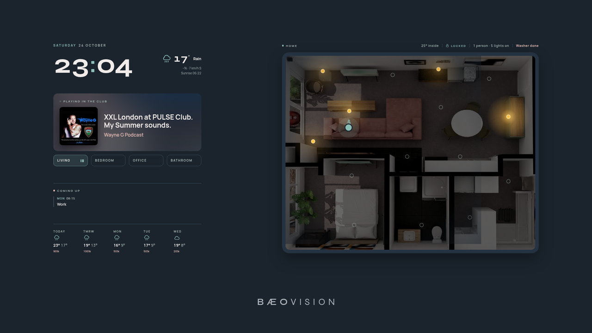

**On the Nest Hubs** (Bæocentre). The same idea, laid out bigger for a 7" screen seen from
across the room: weather, clock, the next alarm (it looks a week ahead), the next event, what's
playing, and the floorplan, where you can tap a lamp to toggle it, and room speakers appear
while they're playing (tap to mute, hold to leave the group). A small service casts the page to
every Nest Hub it finds and puts it back within about 40 seconds if anything knocks it off, but
it never takes over a Hub that's casting something else.

| A normal evening | The washer popup |
|---|---|
| 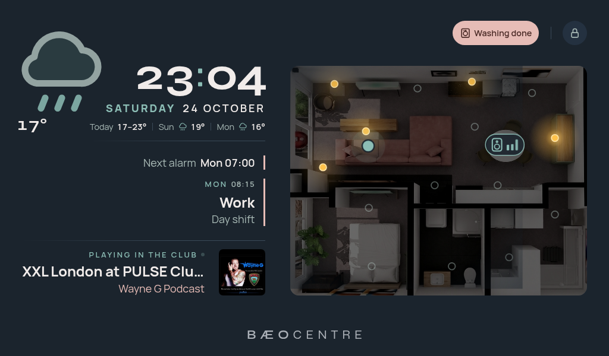 | 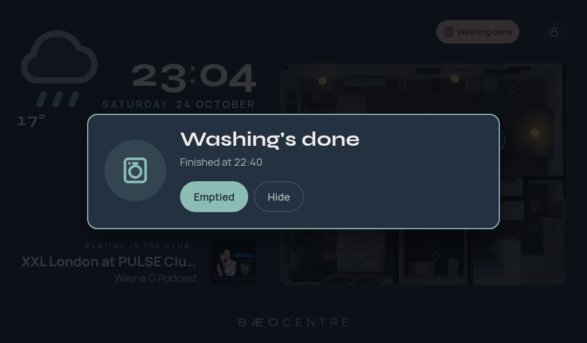 |

The Hub popups are the same list as the remote's, with the same buttons: pressing *Emptied*
on a Hub clears it on the remotes, the knobs and my phone too.

**The remote's guide on the TV.** Holding Menu on a remote also switches the lounge TV to a
one-page cheat sheet of every button, and puts the TV back to whatever it was doing when the
guide closes.

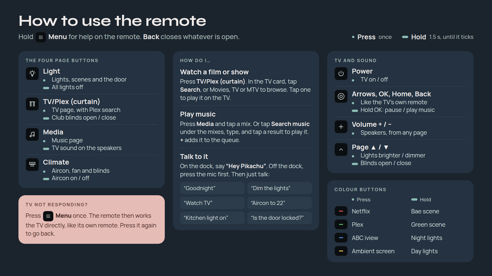

(Calendar text in these screenshots is swapped for a placeholder.)

## One notification script, fire-and-forget
Every phone notification goes through one script. Automations start it with
`script.turn_on` instead of calling it and waiting, so **a failed notification can never stop
an automation**. Each target is sent independently with `continue_on_error`, and the script
is queued (not parallel) so a "clear notification" can never overtake the notification it
clears. Switching phones is a one-line change.

```yaml
notify_bae:
  alias: Notify Bae
  description: Single entry point for phone notifications (added 2026-10-05). Automations
    start it with script.turn_on, so they never wait on it and a failed notification
    can never stop them. Each target is sent separately with continue_on_error, so
    one failing target doesn't stop the others. Queued (not parallel) so a clear_notification
    can't overtake the notification it is meant to clear. To change phones, edit default_targets
    below.
  mode: queued
  max: 50
  max_exceeded: warning
  icon: mdi:cellphone-message
  fields:
    message:
      description: Notification text, or clear_notification.
      required: true
      selector:
        text:
          multiline: true
    title:
      description: Optional title.
      selector:
        text: {}
    data:
      description: Optional mobile_app data (tag, channel, actions, image, ...).
      selector:
        object: {}
    targets:
      description: Optional list of notify actions; defaults to Bae's phone.
      selector:
        object: {}
  sequence:
  - variables:
      default_targets:
      - notify.mobile_app_motorola_razr_50
      send_to: ' {{ [t] if t is string else t | list }}'
      extra: '{{ data if data is defined and data is mapping else {} }}'
      has_title: '{{ title is defined and title is not none and title | string | length
        > 0 }}'
  - repeat:
      for_each: '{{ send_to }}'
      sequence:
      - if: '{{ has_title }}'
        then:
        - action: '{{ repeat.item }}'
          continue_on_error: true
          data:
            title: '{{ title }}'
            message: '{{ message }}'
            data: '{{ extra }}'
        else:
        - action: '{{ repeat.item }}'
          continue_on_error: true
          data:
            message: '{{ message }}'
            data: '{{ extra }}'
```

Calling it looks like this:

```yaml
- action: script.turn_on
  target:
    entity_id: script.notify_bae
  data:
    variables:
      title: Washing's done
      message: Finished at {{ now().strftime('%-I:%M %p') }}
      data:
        tag: washer
        actions:
          - action: WASHER_EMPTIED
            title: Emptied
```

---
[← Back to the overview](../README.md)
